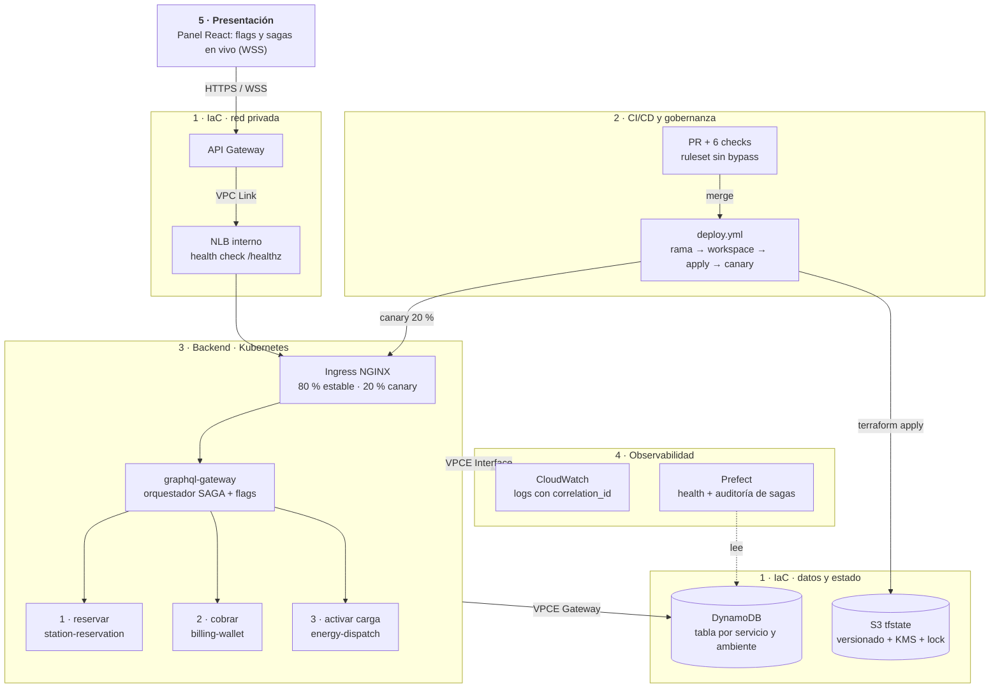
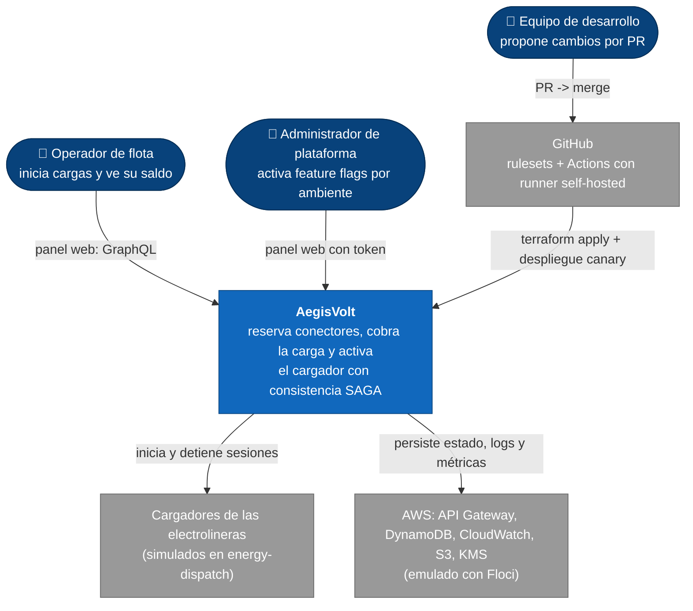
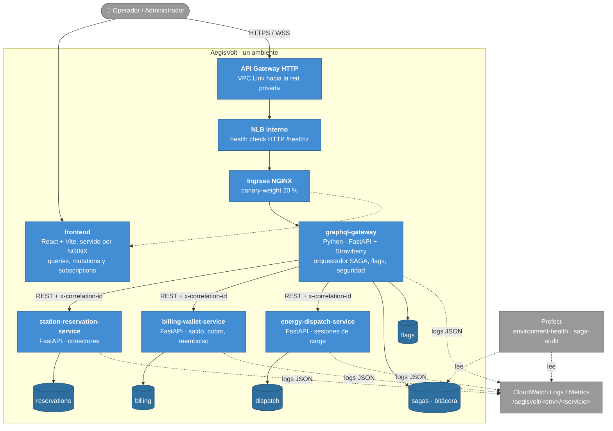
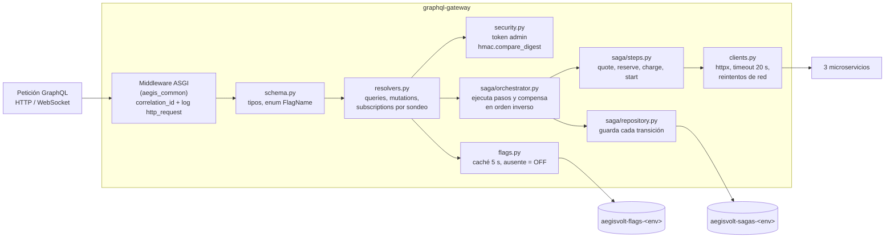
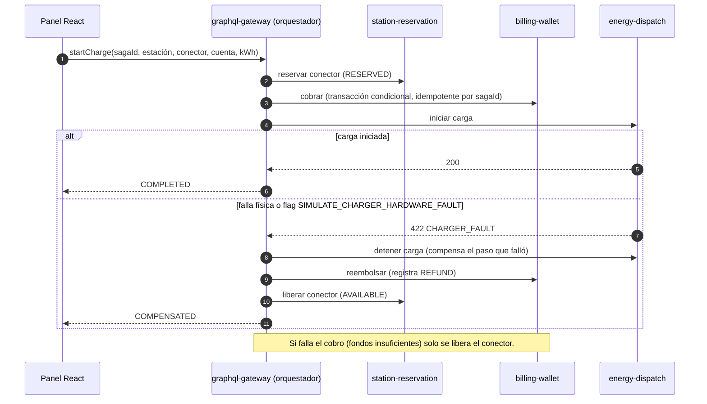
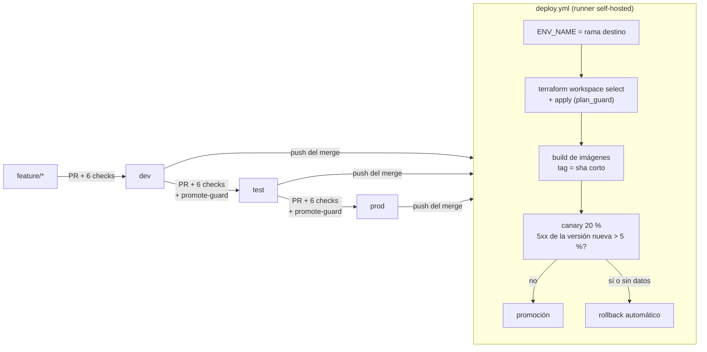

<div align="center">

# ⚡ AegisVolt

**Plataforma cloud-native de gestión de carga para flotas eléctricas y electrolineras**

Proyecto final individual · Patrones Arquitectónicos Avanzados

`SAGA orquestada` · `GraphQL` · `Microservicios en Kubernetes` · `Terraform por workspace` ·
`Canary con rollback automático` · `Feature flags por ambiente` · `CloudWatch + Prefect`

</div>

---

Tres microservicios de dominio detrás de un gateway GraphQL que orquesta una SAGA "Reservar y
activar carga". Infraestructura como código con un workspace por ambiente estático (`dev`,
`test`, `prod`), promoción por PR con checks obligatorios y despliegue canary automático tras
cada merge. AWS se emula en local con **Floci**; Kubernetes corre en **minikube** (un namespace
por ambiente).

## Contenido

1. [Vista para la presentación](#vista-para-la-presentación)
2. [C4 nivel 1: contexto](#c4-nivel-1-contexto)
3. [C4 nivel 2: contenedores](#c4-nivel-2-contenedores)
4. [C4 nivel 3: componentes del gateway](#c4-nivel-3-componentes-del-gateway)
5. [SAGA: camino feliz y compensación](#saga-camino-feliz-y-compensación)
6. [Despliegue y promoción entre ambientes](#despliegue-y-promoción-entre-ambientes)
7. [Stack, estructura y cómo correrlo](#stack)

## Vista para la presentación

Un solo diagrama con las 5 capas que evalúa la rúbrica y el recorrido de una petición.



## C4 nivel 1: contexto



## C4 nivel 2: contenedores



Las tablas llevan el sufijo del ambiente (`aegisvolt-sagas-dev`, `aegisvolt-flags-prod`, …):
cada microservicio es dueño de su tabla y nadie lee la de otro.

## C4 nivel 3: componentes del gateway



## SAGA: camino feliz y compensación



Cada transición se guarda en `aegisvolt-sagas-<env>`; si una compensación falla la saga queda
`FAILED` y la auditoría de Prefect la reporta. El `correlation_id` viaja en `x-correlation-id`
a los 4 servicios: `scripts/trace_saga.py` reconstruye la línea de tiempo desde CloudWatch.

## Despliegue y promoción entre ambientes



- **Ruleset `protected-branches`** en `dev`, `test` y `prod`: sin push directo ni force push, sin
  borrado, PR obligatorio con los 6 checks (`lint-build`, `unit-tests`, `integration-tests`,
  `e2e-tests`, `terraform-plan`, `promote-guard`) y sin bypass.
- **Estado de Terraform** en S3 versionado (`env:/<workspace>/terraform.tfstate`), cifrado con KMS
  propia y lock en DynamoDB; `plan_guard.py` bloquea borrados fuera del workspace.

## Stack

| Capa | Tecnología |
| --- | --- |
| Frontend | React 18 + Vite + TypeScript, `graphql-ws` |
| Backend | Python 3.12, FastAPI, Strawberry GraphQL, httpx, boto3 |
| Datos | DynamoDB (una tabla por servicio y ambiente) |
| Contenedores | Docker, Kubernetes (minikube), Kustomize, Ingress NGINX |
| IaC | Terraform (workspaces), S3 + KMS + DynamoDB lock; módulos `network`, `vpc_endpoints`, `api_gateway`, `eks`, `dynamodb`, `observability` |
| CI/CD | GitHub Actions (`pr-checks.yml`, `deploy.yml`), runner self-hosted, rulesets |
| Observabilidad | CloudWatch Logs/Metrics (JSON con `correlation_id`), Prefect 3 |
| AWS local | Floci (puerto 4566) |

## Estructura

| Carpeta | Contenido |
| --- | --- |
| `services/` | `graphql-gateway` y los 3 microservicios |
| `libs/aegis_common/` | logging a CloudWatch, middleware de `correlation_id` |
| `frontend/` | panel React (estaciones, iniciar carga, flags, historial de sagas) |
| `infra/` | `bootstrap` (bucket del estado + KMS + lock), `envs` y `modules` |
| `k8s/` | manifiestos base + overlays por ambiente (Kustomize) |
| `scripts/` | `deploy.py`, `canary.py`, `plan_guard.py`, `reset_demo.py`, `trace_saga.py`, `saga_test.ps1` |
| `observability/prefect/` | flujos `environment-health` y `saga-audit` |
| `docs/` | plan, runbook, guion de la sustentación y explicaciones |

## Cómo correrlo (resumen)

Requisitos: Docker Desktop, minikube, `uv`, Terraform, AWS CLI, `gh`. Detalle en
[`docs/runbook-demo.md`](docs/runbook-demo.md).

```powershell
docker compose up -d                                        # Floci (AWS local, puerto 4566)
minikube start -p aegisvolt                                 # clúster con addon ingress
uv run python scripts/deploy.py --env dev --tag local1      # build + despliegue escalonado
kubectl -n ingress-nginx port-forward svc/ingress-nginx-controller 8080:80
```

Frontend: `http://dev.aegisvolt.local:8080` (resolver `*.aegisvolt.local` a 127.0.0.1).

## Documentación

- [`docs/guion-sustentacion.md`](docs/guion-sustentacion.md): preparación y guion de la demo.
- [`docs/explicaciones-demo.md`](docs/explicaciones-demo.md): teoría por bloque y preguntas.
- [`docs/runbook-demo.md`](docs/runbook-demo.md): comandos detallados y qué hacer si algo falla.
- [`docs/plan/`](docs/plan/): plan original, fases y plan definitivo.
