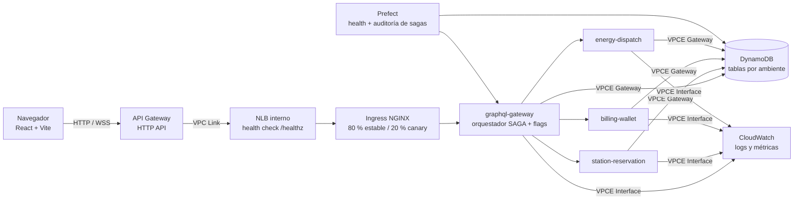

# AegisVolt

Plataforma de carga de vehículos eléctricos: 3 microservicios detrás de un gateway GraphQL que
orquesta una SAGA, con infraestructura como código por ambiente (dev/test/prod), CI/CD con
canary automático y observabilidad. AWS se emula en local con Floci; Kubernetes corre en
minikube (un namespace por ambiente).

## Arquitectura



- **SAGA por orquestación** en el gateway: reservar -> cobrar -> despachar energía; si un paso
  falla, compensa en orden inverso (reembolso, liberar conector). Bitácora en
  `aegisvolt-sagas-<env>`.
- **Feature flags** por ambiente en `aegisvolt-flags-<env>` (caché 5 s, push por suscripción
  GraphQL sobre WSS con sondeo de respaldo).
- **IaC:** Terraform con un workspace por ambiente; estado en S3 versionado y cifrado con KMS
  propia, lock en DynamoDB. Módulos: `network`, `vpc_endpoints`, `api_gateway`, `eks`,
  `dynamodb`, `observability`.
- **CI/CD:** `pr-checks.yml` (lint, unit, integración, e2e, seguridad, `terraform-plan`,
  `promote-guard`) protege `dev`, `test` y `prod` con rulesets. `deploy.yml` corre tras el merge:
  rama -> workspace -> `terraform apply` -> build -> canary 20 % con métricas de CloudWatch ->
  promoción o rollback automático.

## Estructura

| Carpeta | Contenido |
| --- | --- |
| `services/` | `graphql-gateway` y los 3 microservicios (FastAPI) |
| `libs/` | `aegis_common`: logging a CloudWatch, `correlation_id`, utilidades |
| `frontend/` | panel React (conectores, SAGA, flags) |
| `infra/` | `bootstrap` (bucket del estado + KMS + lock), `envs` y `modules` |
| `k8s/` | manifiestos base + overlays por ambiente (Kustomize) |
| `scripts/` | `deploy.py`, `canary.py`, `plan_guard.py`, `saga_test.ps1`, ... |
| `observability/prefect/` | flujos de health y auditoría de sagas |
| `docs/` | plan, runbook de la demo, guion y explicaciones |

## Cómo correrlo (resumen)

Requisitos: Docker Desktop, minikube, `uv`, Terraform, AWS CLI, `gh`. Detalle en
`docs/runbook-demo.md`.

```powershell
docker compose up -d                                   # Floci (AWS local, puerto 4566)
minikube start -p aegisvolt                            # clúster con addon ingress
uv run python scripts/deploy.py --env dev              # build + despliegue escalonado
kubectl -n ingress-nginx port-forward svc/ingress-nginx-controller 8080:80
```

Frontend: `http://dev.aegisvolt.local:8080` (resolver `*.aegisvolt.local` a 127.0.0.1).

## Documentación

- `docs/guion-sustentacion.md`: preparación y guion de la demo.
- `docs/explicaciones-demo.md`: teoría por bloque y preguntas difíciles.
- `docs/runbook-demo.md`: comandos detallados y qué hacer si algo falla.
- `docs/plan/`: plan original, fases y plan definitivo.
